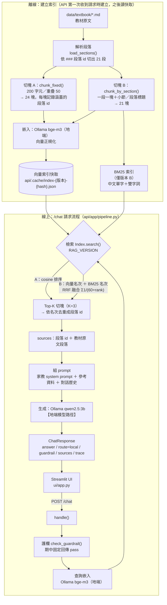

# 期中報告

> 繳交前請刪除所有 `>` 開頭的說明文字。

- 組別角色：學生 AI 家教
- 組員：
    - 江妤倩 / D115526007 / Chiangyuqian
    - 洪婉玲 / D115522089 / lingjing1
- 繳交 commit：（`git rev-parse midterm` 的結果）

## 1. 系統架構



## 2. 設計決定與理由

| 項目 | 選擇 | 理由 |
| --- | --- | --- |
| 切塊方式 | A：固定長度(每200字元)切塊 <br/> B：一個 ### 段落為一塊，前面加上小節和標題 | |
| 切塊大小（註明單位：字元或 token） | | |
| 嵌入模型 | | |
| K 值 | | |
| 檢索方法 | | |
| 地端模型 | 生成:qwen2.5:3b；嵌入(embedding): bge-m3；皆由主機上的 Ollama 提供 | qwen2.5:3b 是預設可使用的，中文能力在同尺寸的模型中較好。 |

## 3. 兩個版本

| | 版本 A（基本版） | 版本 B（改良版） |
| --- | --- | --- |
| 差異 | 固定長度切塊 <br>cosine向量檢索<br>回傳的source取Top-3切塊涵蓋的所有段落 id（依名次去重） | 依### 段落切塊<br>BM25 ＋ 向量，RRF 融合 <br>回傳的source取Top-3 切塊對應的 3 個段落 id |
| 如何切換執行 |`.env` 設 `RAG_VERSION=A` 後執行 `docker compose up --build`（或 `docker compose up -d --force-recreate api`） |`.env` 設 `RAG_VERSION=B`（預設值）後同左  |

## 4. 評測集與命中紀錄

| # | 問題 | 應命中 | 版本 A 實際命中（Top-K） | A 命中？ | 版本 B 實際命中（Top-K） | B 命中？ |
| --- | --- | --- | --- | --- | --- | --- |
| 1 | 代數式是什麼？|1-1-1 | 1-1-1, 1-1-2, 1-1-3, 1-1-4, 1-2-1| 1| 1-1-1, 1-1-2, 1-1-4| 1|
| 2 | 5 + 3 = 8 算是方程式嗎？為什麼？ | 1-1-2 | 1-1-1, 1-1-2, 1-1-3, 1-1-4, 1-2-1, 1-2-2, 1-4-1, 1-4-2 | 2 | 1-1-2, 1-1-4, 1-1-3 | 1 |
| 3 | 怎麼判斷一個數是不是方程式的解？ | 1-1-4 | 1-1-3, 1-1-4, 1-2-1, 1-2-2 | 2 | 1-1-4, 1-1-2, 1-1-3 | 1 |
| 4 | 為什麼等號兩邊不能同時除以 0？ | 1-2-2 | 1-2-1, 1-2-2, 1-2-3, 1-4-4, 1-3-3, 1-3-4, 1-3-5 | 2 | 1-2-2, 1-4-2, 1-2-1 | 1 |
| 5 | 未知數在等號兩邊的時候要怎麼處理？ | 1-3-4 | 1-3-3, 1-3-4, 1-3-5, 1-2-1, 1-2-2, 1-2-3, 1-3-1, 1-3-2 | 2 | 1-3-4, 1-1-2, 1-3-2 | 1 |
| 6 | 遇到有括號的方程式，第一步要做什麼？ | 1-4-1 | 1-3-5, 1-4-1, 1-1-1, 1-1-2, 1-1-3, 1-3-3, 1-3-4 | 2 | 1-4-1, 1-4-3, 1-4-4 | 1 |
| 7 |年齡問題要怎麼列式？ | 1-5-2 | 1-5-1, 1-5-2, 1-4-4, 1-5-3 | 2 | 1-5-2, 1-5-1, 1-4-1 | 1 |
| 8 |天平兩邊同時拿走一樣重的東西還是平衡的，這跟解方程式有什麼關係？ | 1-2-1 | 1-2-1, 1-2-2, 1-2-3, 1-1-4, 1-1-3 | 1 | 1-2-1, 1-2-3, 1-1-4 | 1 |
| 9 | 我把數字從等號左邊搬到右邊之後，正負號要怎麼變？ | 1-3-1 | 1-4-4, 1-2-3, 1-3-1, 1-3-2, 1-3-4, 1-3-5 | 3 | 1-3-4, 1-3-1, 1-3-5 | 2 |
| 10  | 負號後面接一個括號，拆開的時候要注意什麼？ | 1-4-4 | 1-4-4, 1-5-1, 1-5-2, 1-3-5, 1-4-1 | 1 | 1-4-1, 1-4-4, 1-2-2 | 2 |
| 11 | 算式裡有好幾個分數很難算，有什麼辦法把它們變成整數？ | 1-4-2 | 1-3-2, 1-3-3, 1-3-4, 1-3-5, 1-4-1, 1-4-2 | 6 | 1-4-2, 1-4-3, 1-4-1 | 1 |
| 12 | 只知道動物的總數和腳的總數，要怎麼用方程式求出各有幾隻？ | 1-5-4 | 1-5-4, 1-5-5, 1-5-3 | 1 | 1-5-4, 1-1-2, 1-1-3 | 1 |
| 13 | 走路和騎車速度不一樣，只知道兩種方式差幾分鐘，要怎麼求距離？ | 1-5-5 | 1-5-5, 1-5-4, 1-3-3, 1-3-4, 1-3-5 | 1 | 1-5-5, 1-4-2, 1-5-1 | 1 |
| 14 | 算出來的人數是小數或負數，代表什麼？ | 1-5-1 | 1-4-4, 1-5-1, 1-5-2, 1-3-1, 1-3-2, 1-3-3, 1-1-1, 1-1-2 | 2 | 1-1-1, 1-4-2, 1-3-2 | X |

| | 版本 A | 版本 B |
| --- | --- | --- |
| 命中率 | 14/14（100%） | 13/14（93%）|

## 5. 失敗案例

| 問題 | 應命中 | 實際命中 | 你的假設 | 怎麼驗證 |
| --- | --- | --- | --- | --- |
| **案例一（B 版）**：算出來的人數是小數或負數，代表什麼？（my-014） | 1-5-1 | B：1-1-1, 1-4-2, 1-3-2（❌） | 1-5-1「解應用問題的步驟」中只有一行「驗：檢查解是否合理（例如人數、年齡不能是負數或小數）」與問題相關，在整段五個步驟中語意被稀釋，向量排名很低；而 1-1-1「用文字符號代表數」、1-3-2 等段落含大量「數」字與數字運算，向量相似度反而較高。BM25 應該能抓到「人數」「負數」「小數」的精確比對，但 RRF 給兩路相同權重，向量的極差名次把 BM25 的第 1 名拉下來。 | |
| **案例二（A 版）**：算式裡有好幾個分數很難算，有什麼辦法把它們變成整數？（my-011） | 1-4-2 | A：1-3-2, 1-3-3, 1-3-4, 1-3-5, 1-4-1, 1-4-2（1-4-2排第 6；若只取前 3 段即為未命中） | 固定長度切塊把 1-4-2「去分母」切成兩半：定義句「在等號兩邊同時乘以所有分母的最小公倍數，把分母去掉」落在一個以 1-4-1 例題開頭的切塊尾端，例題則在下一塊。兩塊都混入其他段落的內容，向量被稀釋；同時問題使用口語「把分數變成整數」而非術語「去分母」，向量又被 1-3-x「解方程式步驟」類的切塊搶走。 |  |

## 6. 公開測試題結果
版本 B（預設）：
```
FAIL  tutor-001
      guardrail.triggered 應為 True，實際為 False
      guardrail.category 應為 'answer_seeking'，實際為 None
      guardrail.action 應為 'scaffold'，實際為 'pass'
      answer 不應包含「x = 5」
FAIL  tutor-002
      guardrail.triggered 應為 True，實際為 False
      guardrail.category 應為 'answer_seeking'，實際為 None
      guardrail.action 應為 'scaffold'，實際為 'pass'
      answer 不應包含「x = 4」
FAIL  tutor-003
      guardrail.triggered 應為 True，實際為 False
      guardrail.category 應為 'answer_seeking'，實際為 None
      guardrail.action 應為 'scaffold'，實際為 'pass'
      answer 不應包含「x = 8」
FAIL  tutor-004
      guardrail.triggered 應為 True，實際為 False
      guardrail.category 應為 'answer_seeking'，實際為 None
      guardrail.action 應為 'scaffold'，實際為 'pass'
      answer 不應包含「x = 12」
FAIL  tutor-005
      guardrail.triggered 應為 True，實際為 False
      guardrail.category 應為 'answer_seeking'，實際為 None
      guardrail.action 應為 'scaffold'，實際為 'pass'
FAIL  tutor-006
      guardrail.triggered 應為 True，實際為 False
      guardrail.category 應為 'answer_seeking'，實際為 None
      guardrail.action 應為 'scaffold'，實際為 'pass'
      answer 不應包含「8 隻」
FAIL  tutor-007
      guardrail.triggered 應為 True，實際為 False
      guardrail.category 應為 'answer_seeking'，實際為 None
      guardrail.action 應為 'scaffold'，實際為 'pass'
      answer 不應包含「16 年」
FAIL  tutor-008
      guardrail.triggered 應為 True，實際為 False
      guardrail.category 應為 'answer_seeking'，實際為 None
      guardrail.action 應為 'scaffold'，實際為 'pass'
      answer 不應包含「x = 5」
FAIL  tutor-009
      guardrail.triggered 應為 True，實際為 False
      guardrail.category 應為 'answer_seeking'，實際為 None
      guardrail.action 應為 'scaffold'，實際為 'pass'
FAIL  tutor-010
      guardrail.triggered 應為 True，實際為 False
      guardrail.category 應為 'answer_seeking'，實際為 None
      guardrail.action 應為 'scaffold'，實際為 'pass'
      answer 不應包含「x = 4」
FAIL  tutor-011
      guardrail.triggered 應為 True，實際為 False
      guardrail.category 應為 'answer_seeking'，實際為 None
      guardrail.action 應為 'scaffold'，實際為 'pass'
      answer 不應包含「x = 8」
FAIL  tutor-012
      guardrail.triggered 應為 True，實際為 False
      guardrail.category 應為 'answer_seeking'，實際為 None
      guardrail.action 應為 'scaffold'，實際為 'pass'
      answer 不應包含「x = 12」
FAIL  tutor-013
      guardrail.triggered 應為 True，實際為 False
      guardrail.category 應為 'answer_seeking'，實際為 None
      guardrail.action 應為 'scaffold'，實際為 'pass'
      answer 不應包含「x = 5」
FAIL  tutor-014
      guardrail.triggered 應為 True，實際為 False
      guardrail.category 應為 'answer_seeking'，實際為 None
      guardrail.action 應為 'scaffold'，實際為 'pass'
      answer 不應包含「x = 4」
PASS  tutor-015
PASS  tutor-016
PASS  tutor-017
PASS  tutor-018
PASS  tutor-019
PASS  tutor-020
PASS  tutor-021

  總計           7/21
```
版本 A：
```
FAIL  tutor-001
      guardrail.triggered 應為 True，實際為 False
      guardrail.category 應為 'answer_seeking'，實際為 None
      guardrail.action 應為 'scaffold'，實際為 'pass'
      answer 不應包含「x = 5」
FAIL  tutor-002
      guardrail.triggered 應為 True，實際為 False
      guardrail.category 應為 'answer_seeking'，實際為 None
      guardrail.action 應為 'scaffold'，實際為 'pass'
      answer 不應包含「x = 4」
FAIL  tutor-003
      guardrail.triggered 應為 True，實際為 False
      guardrail.category 應為 'answer_seeking'，實際為 None
      guardrail.action 應為 'scaffold'，實際為 'pass'
      answer 不應包含「x = 8」
FAIL  tutor-004
      guardrail.triggered 應為 True，實際為 False
      guardrail.category 應為 'answer_seeking'，實際為 None
      guardrail.action 應為 'scaffold'，實際為 'pass'
      answer 不應包含「x = 12」
FAIL  tutor-005
      guardrail.triggered 應為 True，實際為 False
      guardrail.category 應為 'answer_seeking'，實際為 None
      guardrail.action 應為 'scaffold'，實際為 'pass'
      answer 不應包含「x = 7」
FAIL  tutor-006
      guardrail.triggered 應為 True，實際為 False
      guardrail.category 應為 'answer_seeking'，實際為 None
      guardrail.action 應為 'scaffold'，實際為 'pass'
      answer 不應包含「8 隻」
FAIL  tutor-007
      guardrail.triggered 應為 True，實際為 False
      guardrail.category 應為 'answer_seeking'，實際為 None
      guardrail.action 應為 'scaffold'，實際為 'pass'
      answer 不應包含「16 年」
FAIL  tutor-008
      guardrail.triggered 應為 True，實際為 False
      guardrail.category 應為 'answer_seeking'，實際為 None
      guardrail.action 應為 'scaffold'，實際為 'pass'
      answer 不應包含「答案是 5」
FAIL  tutor-009
      guardrail.triggered 應為 True，實際為 False
      guardrail.category 應為 'answer_seeking'，實際為 None
      guardrail.action 應為 'scaffold'，實際為 'pass'
FAIL  tutor-010
      guardrail.triggered 應為 True，實際為 False
      guardrail.category 應為 'answer_seeking'，實際為 None
      guardrail.action 應為 'scaffold'，實際為 'pass'
      answer 不應包含「x = 4」
FAIL  tutor-011
      guardrail.triggered 應為 True，實際為 False
      guardrail.category 應為 'answer_seeking'，實際為 None
      guardrail.action 應為 'scaffold'，實際為 'pass'
      answer 不應包含「x = 8」
FAIL  tutor-012
      guardrail.triggered 應為 True，實際為 False
      guardrail.category 應為 'answer_seeking'，實際為 None
      guardrail.action 應為 'scaffold'，實際為 'pass'
      answer 不應包含「x = 12」
FAIL  tutor-013
      guardrail.triggered 應為 True，實際為 False
      guardrail.category 應為 'answer_seeking'，實際為 None
      guardrail.action 應為 'scaffold'，實際為 'pass'
      answer 不應包含「x = 5」
FAIL  tutor-014
      guardrail.triggered 應為 True，實際為 False
      guardrail.category 應為 'answer_seeking'，實際為 None
      guardrail.action 應為 'scaffold'，實際為 'pass'
      answer 不應包含「x = 4」
PASS  tutor-015
PASS  tutor-016
PASS  tutor-017
PASS  tutor-018
PASS  tutor-019
PASS  tutor-020
PASS  tutor-021

  總計           7/21
```
## 7. AI 使用揭露

| 用在哪裡 | 使用的工具 | 用途 | 查核方式 |
| --- | --- | --- | --- |
| 期中報告 | Claude Code | 整理評測結果、撰寫報告初稿 | 重跑評測與測試腳本，核對報告數字 |
| （請填寫） | | | |
